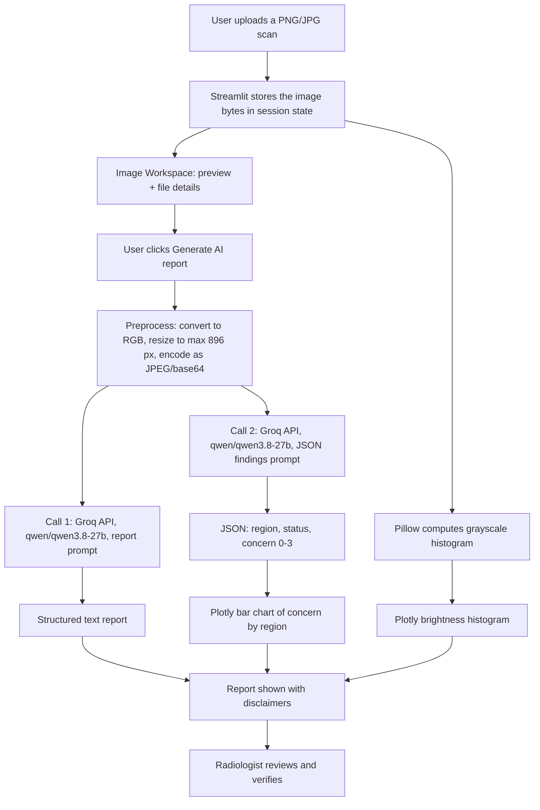

# 🧠 NeuroAlert AI

AI-assisted brain CT review app built with Streamlit. Upload a scan to get a draft radiology-style report and charts for expert review.

> **⚠️ Disclaimer:** NeuroAlert AI is a student research prototype. It is **not a medical device**, has **not been clinically validated**, and must **not** be used for diagnosis, treatment decisions, or emergencies. All AI output is a draft that must be verified by a qualified radiologist.

---

## Table of contents

1. [What it does](#what-it-does)
2. [Project workflow](#project-workflow)
3. [Why the Qwen model](#why-the-qwen-model)
4. [Tech stack](#tech-stack)
5. [Getting started](#getting-started)
6. [Project structure](#project-structure)
7. [Limitations](#limitations)
8. [Roadmap](#roadmap)

---

## What it does

- **Image upload and preview** for PNG/JPG scans, with file details and a download option
- **AI-drafted observation report** in a structured, radiology-style format: image quality, skull, brain tissue, ventricles, midline shift, features that could suggest hemorrhage, confidence, limitations, and a suggested next step
- **Concern-level chart** showing the AI's visual estimate for each region (0 = none, 3 = high)
- **Brightness histogram** computed directly from the image pixels
- **AI Integration Roadmap** page describing how to move from this prototype to a properly trained and evaluated model

## Project workflow



### Step by step

1. **Upload.** The user uploads a PNG or JPG. The app keeps the raw bytes in Streamlit's session state and shows a preview with file details.
2. **Preprocess.** When **Generate AI report** is clicked, the image is converted to RGB, resized to at most 896 px, saved as JPEG, and base64-encoded. This keeps requests small and fast.
3. **Report generation.** The image and a carefully written prompt go to the vision model. The prompt asks for a fixed set of headings, cautious wording ("appears", "possible", "cannot be excluded"), a confidence level, limitations, and a note that the output is a draft for radiologist review. It tells the model to state when the image is not a brain CT and not to invent findings.
4. **Structured findings.** A second call asks the model for JSON only: a status and a 0 to 3 concern score for each of six regions. JSON mode makes the output easy to parse and plot.
5. **Charts.** The JSON becomes a Plotly bar chart. Separately, Pillow computes a grayscale histogram from the image pixels, which is the only chart computed from the image itself.
6. **Safeguards.** Every output carries a "not a diagnosis, verify with a radiologist" message. If an API call fails, the app shows an error and keeps working.
7. **Human review.** The app is designed as decision support. A qualified radiologist makes the final read.

## Why the Qwen model

The app uses **`qwen/qwen3.8-27b`** through the Groq API. The reasons are practical and honest:

- **It is multimodal.** It accepts both an image and text in the same request, which this app needs.
- **It is available on Groq's free tier.** Earlier Groq vision models, such as the Llama 4 Scout model used in the first version, were no longer available, and this model is the one Groq's vision documentation lists as the current choice.
- **It supports JSON mode.** The concern chart depends on clean, parseable JSON output.
- **It has a large context window (131K tokens).** This leaves room for long, detailed prompts.
- **It is fast on Groq.** Low latency makes the app feel responsive during a live demo.
- **The model is easy to swap.** The model name lives in one `MODELS` list in `app.py`, so it can be changed in seconds if Groq retires or renames it.

**Why not Gemini?** The first version used Google's Gemini API. The free tier's daily request limit was reached during testing, and some models were retired or overloaded, which caused errors. Switching to Groq made the demo more reliable.

**Important:** Qwen was chosen for availability, speed, and features. It was **not** chosen because it is proven for medical imaging. It is a general-purpose model, has not been validated on radiology data, and can make mistakes.

## Tech stack

- Python
- Streamlit
- Pandas and Plotly
- Pillow
- Groq API (vision model: `qwen/qwen3.8-27b`)

## Getting started

### 1. Clone the repository

```bash
git clone https://github.com/<your-username>/NeuroAlert-AI.git
cd NeuroAlert-AI
```

### 2. Create a virtual environment and install dependencies (Windows)

```powershell
py -3.12 -m venv .venv
.\.venv\Scripts\python.exe -m pip install -r requirements.txt
```

`requirements.txt` contains:

```
streamlit
pandas
plotly
pillow
groq
```

### 3. Add your Groq API key

Get a free key at [console.groq.com/keys](https://console.groq.com/keys), then create `.streamlit/secrets.toml`:

```toml
GROQ_API_KEY = "your-key-here"
```

> Never commit this file. It is listed in `.gitignore`.

### 4. Run the app

```powershell
.\.venv\Scripts\python.exe -m streamlit run app.py
```

Open the local URL shown in the terminal, usually `http://localhost:8501`. To open it from another device on the same Wi-Fi, run with `--server.address 0.0.0.0` and use the Network URL shown in the terminal.

### Deploying on Streamlit Community Cloud (optional)

1. Push the repository to GitHub, without `secrets.toml` or `.venv`.
2. At [share.streamlit.io](https://share.streamlit.io), create an app from the repo and choose `app.py`.
3. Under **Advanced settings → Secrets**, paste `GROQ_API_KEY = "your-key-here"`.
4. Deploy. You get a public link that works on any network.

## Project structure

```
NeuroAlert-AI/
├── app.py              # Streamlit app and AI report logic
├── requirements.txt    # Python dependencies
├── .gitignore          # Keeps secrets and the virtual environment out of Git
└── .streamlit/
    └── secrets.toml    # Your API key (not committed)
```

## Limitations

- A general-purpose vision model is not a trained medical detector. It can miss findings or describe things that are not there.
- The AI report has not been validated against radiologist reports.
- The concern chart shows AI visual estimates, not measured values.
- Model names and free-tier limits on Groq change over time. If you get a "model not found" error, check [console.groq.com/docs/vision](https://console.groq.com/docs/vision) for a current vision model and update `MODELS` in `app.py`.
- Free tiers have rate limits. If you see a 429 error, wait a minute and try again.
- Use **public or educational sample images only**. Do not upload real patient scans, since images are sent to an external API.

## Roadmap

- Train a classifier on a public dataset such as RSNA Intracranial Hemorrhage or CQ500
- Evaluate on a held-out, patient-level test set (sensitivity, specificity, AUROC, calibration)
- Add a model card and report real metrics
- Export the report as PDF
- Deploy on Streamlit Community Cloud

## License

Add a license of your choice (for example MIT) before sharing publicly.

## Acknowledgements

Built as a student research and hackathon project. Thanks to the open datasets and open-source tools that make this kind of work possible.